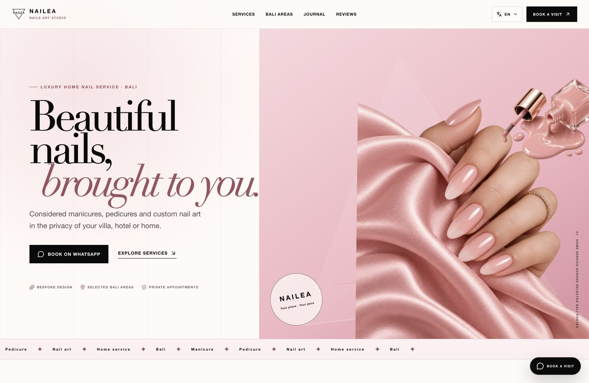
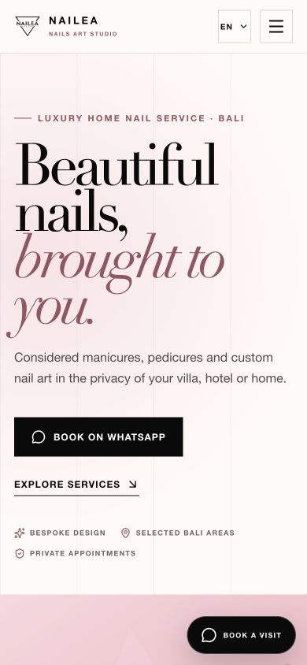

<p align="center">
  
</p>

<p align="center">
  A multilingual website for a premium mobile nail service in Bali,<br />
  bringing manicure, pedicure and custom nail art into a personal booking experience.
</p>

<p align="center">
  <a href="https://balinailstudio.com/en"><strong>Live website ↗</strong></a>
  &nbsp;·&nbsp;
  <a href="#the-project">The project</a>
  &nbsp;·&nbsp;
  <a href="#features">Features</a>
  &nbsp;·&nbsp;
  <a href="#run-locally">Run locally</a>
  &nbsp;·&nbsp;
  <a href="#built-by">Get in touch</a>
</p>

<p align="center">
  <a href="https://balinailstudio.com/en">
    
  </a>
</p>

<p align="center">
  <sub>Header and hero captured from the deployed website. Also available on the <a href="https://nailea-nails-studio.vercel.app/en">Vercel deployment</a>.</sub>
</p>

<p align="center">
  <code>Next.js 16</code>&nbsp;
  <code>React 19</code>&nbsp;
  <code>TypeScript</code>&nbsp;
  <code>Tailwind CSS 4</code>&nbsp;
  <code>EN / ID / RU</code>
</p>

## The project

Nailea Nails Art Studio offers manicure, pedicure and custom nail art at selected
homes, villas and hotels in Bali. The website introduces that service through a
blush, black and ivory identity, bespoke brand imagery and a direct WhatsApp
booking journey.

The implementation includes eight service pages, six Bali-area pages and six
journal articles, available in English, Bahasa Indonesia and Russian. Shared
templates bring consistency to the content while keeping service details,
location advice and article copy specific to each page.

## Features

| Area | What is included |
| :--- | :--- |
| **Visual identity** | Blush pink, black and ivory styling, bold editorial typography, layered nail artwork and a responsive branded header. |
| **Three languages** | Dedicated `/en`, `/id` and `/ru` routes, browser-language detection, an English fallback and a saved language cookie. |
| **Service discovery** | Pages for mobile nail appointments, nail art, gel, manicure, pedicure, extensions, French nails and chrome finishes. |
| **Local content** | Individual pages for Canggu, Seminyak, Kerobokan, Ubud, Sanur and Uluwatu, with address availability confirmed before booking. |
| **Booking** | WhatsApp calls to action with localized default messages, plus environment-driven business and contact details. |
| **Bali map** | An embedded OpenStreetMap view with a dark neon treatment and location markers. |
| **Journal & FAQs** | Six localized articles, service guidance and expandable frequently asked questions. |
| **Search & sharing** | Page-specific metadata, canonical and hreflang links, multilingual sitemap, structured data, social metadata and LLM text files. |

The language switcher preserves the current service, area or article path when
changing language, so visitors can continue exploring the same content.

<details>
  <summary><strong>View the mobile preview</strong></summary>
  <br />
  <p align="center">
    
  </p>
</details>

## Technology

| Layer | Tools |
| :--- | :--- |
| Application | Next.js App Router, React and strict TypeScript |
| Interface | Tailwind CSS, Lucide icons and supplied brand artwork |
| Localization | Locale-prefixed routes, translated content and request-level language selection |
| Content | Typed service, location and journal data with shared page templates |
| Maps & delivery | OpenStreetMap embedding and Vercel deployment, with standalone output retained for local and Docker builds |

## Run locally

Use **Node.js 24.x** and **Bun**.

```bash
git clone https://github.com/arasors/nailea-nails-studio.git
cd nailea-nails-studio
bun install --frozen-lockfile
cp .env.example .env.local
bun run dev
```

Open [localhost:3000](http://localhost:3000). The first request selects a supported
language from the saved preference or browser language; unsupported languages fall
back to English. You can open `/en`, `/id` or `/ru` directly.

| Command | Purpose |
| :--- | :--- |
| `bun run dev` | Start the development server |
| `bun run check` | Run lint, TypeScript checks and the production build |
| `bun run build` | Create a production build |
| `bun run start` | Serve the production build |

<details>
  <summary><strong>Configuration and project structure</strong></summary>

### Configuration

All supported settings are documented in [`.env.example`](./.env.example).

- **Production origin:** set `NEXT_PUBLIC_SITE_URL` so canonical, hreflang,
  sitemap and structured-data URLs use the final domain.
- **Booking and contact:** configure WhatsApp, localized default messages,
  Instagram, email and the current service-area summary.
- **Tracking and verification:** optional Google Analytics 4, Google Tag Manager,
  Yandex Metrica, Meta Pixel and search-engine verification settings.

Variables prefixed with `NEXT_PUBLIC_` are included in the browser build. Update
them before building, and keep private credentials out of them.

### Structure

```text
src/app/[locale]/         Localized home, service, area, journal and review routes
src/components/           Shared sections, navigation, booking CTA and Bali map
src/lib/content.ts        Typed services, Bali areas and journal content
src/lib/localized-content.ts  Translated content for shared page templates
src/lib/locale-config.ts  Supported locales, paths and language alternates
src/lib/site.ts           Environment-driven business configuration
src/proxy.ts              Browser-language and cookie-based route selection
public/images/nailea/     Brand artwork and social assets
docs/readme/              Project header and live website screenshots
```

The reviews route uses sample data from [`src/lib/reviews.ts`](./src/lib/reviews.ts).

</details>

<details>
  <summary><strong>Maintaining the project showcase</strong></summary>

Keep the screenshots aligned with the shipped header and hero. The current
captures use the English homepage at 1600×1040 and 390×844.

The [project README guide](./docs/PROJECT_README_GUIDE.md) records the shared
format for other repositories: project identity, a real interface preview,
verified features, local setup and author links.

</details>

## Built by

**[Aras Örs](https://github.com/arasors)** · Full stack engineer and founder of
[SENTROY](https://sentroy.com/).

For a website, a product build or an application that needs to move forward,
connect on [LinkedIn](https://www.linkedin.com/in/arasors/) or
[Upwork](https://www.upwork.com/freelancers/~01ee3382ccf6d07f2e).

<p align="center">
  <sub>Built by <a href="https://github.com/arasors">Aras Örs</a></sub>
</p>
